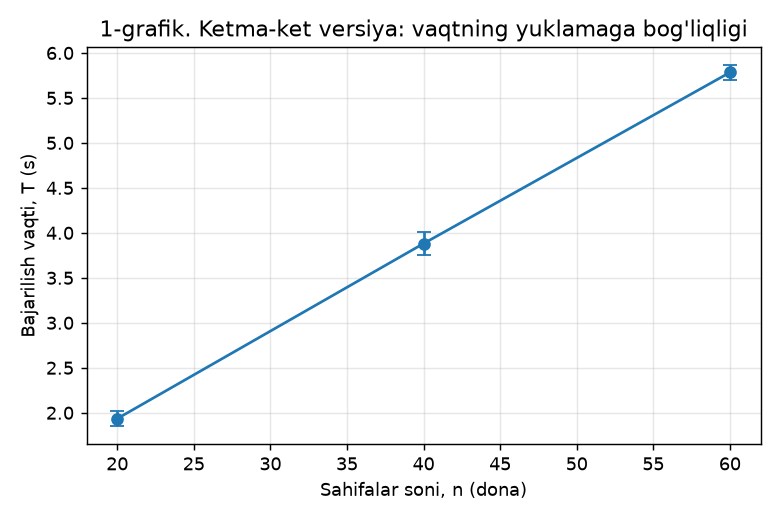
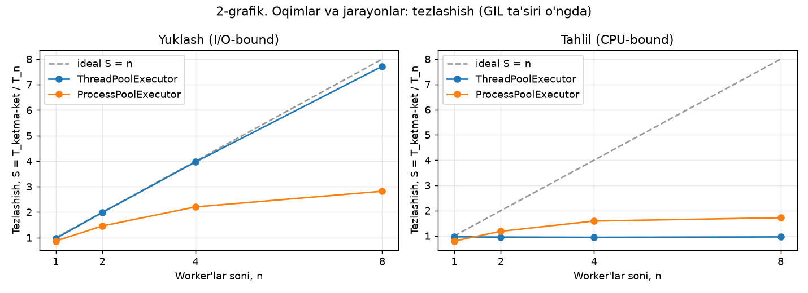
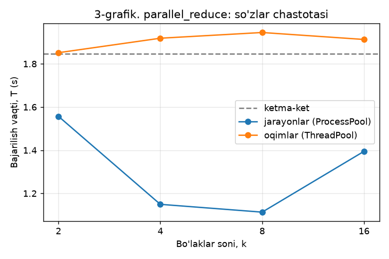
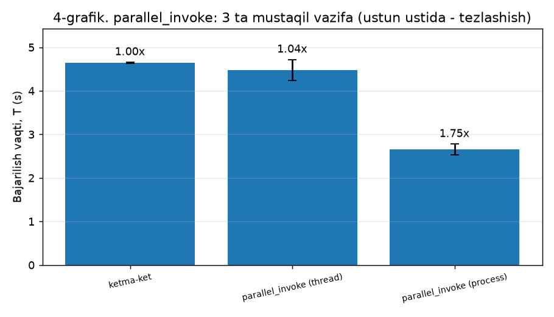
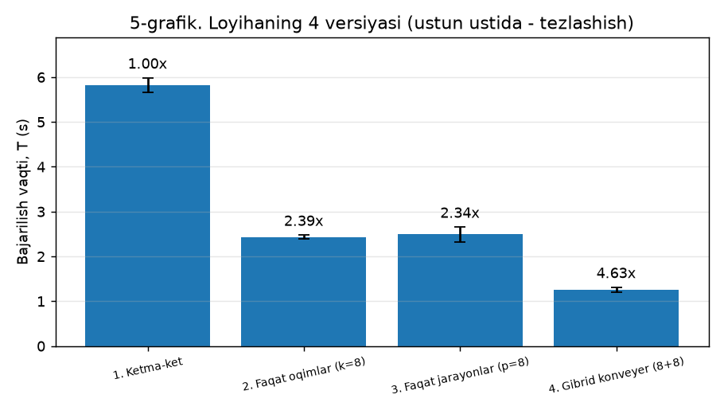
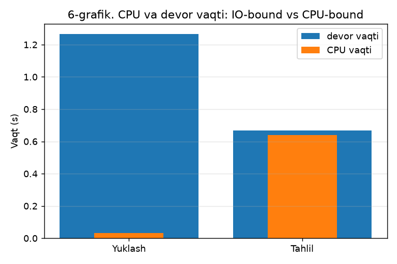

# Parallel veb-skreyper va matn tahlili tizimi - 2-topshiriq natijalari

**Yo'nalish:** B (loyiha). **Bajardi:** Boltayev Elbek, Soyibjonov Otabek.
**Sana:** 2026-10-13 23:40

## Jamoa a'zolarining hissasi

| A'zo | Funksiyalar |
|---|---|
| Boltayev Elbek | `build_vocabulary`, `generate_page`, `make_handler`, `_server_process_main`, `LocalTestServer.__init__`, `PoliteGate.__init__`, `PoliteGate.allowed`, `PoliteGate.slot`, `FetchStats.__init__`, `FetchStats.record`, `_get_gate`, `_http_get`, `fetch_page`, `_fetch_tracked`, `fetch_sequential`, `fetch_parallel`, `race_condition_demo`, `pipeline_producer`, `parallel_invoke`, `task_download`, `task_page_stats`, `exp_fetch_workers`, `exp_sync`, `exp_invoke` |
| Soyibjonov Otabek | `html_to_text`, `analyze_html`, `analyze_sequential`, `analyze_parallel`, `task_build_index`, `split_chunks`, `count_chunk`, `merge_counters`, `parallel_reduce`, `pipeline_consumer`, `measure`, `cpu_wall`, `counter_digest`, `pages_digest`, `check`, `exp_profiling`, `exp_baseline`, `exp_analyze_workers`, `exp_reduce`, `collect_env`, `fmt_table`, `make_charts`, `conclusions`, `write_report`, `run_self_tests` |
| Ikkalasi | `run_pipeline`, `exp_versions`, `parse_args`, `run_all`, `main` |

## Sinov muhiti

| Parametr | Qiymat |
|---|---|
| OT | Windows 11 (10.0.26300) |
| Protsessor | AMD64 Family 25 Model 68 Stepping 1, AuthenticAMD |
| Mantiqiy yadrolar | 16 |
| Operativ xotira | noma'lum |
| GPU | ishlatilmaydi |
| Python | CPython 3.13.9 |
| requests | 2.34.2 |
| beautifulsoup4 | 4.15.0 |
| matplotlib | 3.11.2 |
| multiprocessing start method | spawn |

## O'lchash metodikasi

- Ma'lumot manbai: lokal sinov serveri; tarmoq kechikishi 0.05 s/sahifa, sahifa hajmi ~100 KB.
- Har bir o'lchov 3 marta takrorlanib o'rtacha olinadi; **birinchi (qizdirish) yurishi hisobga olinmaydi** - unda importlar, robots.txt keshi va OT kesh to'ladi.
- Tezlashish S = T_ketma-ket / T_n, samaradorlik E = S / n.

## 1. Profiling (cProfile, 20 sahifa, ketma-ket)

| Funksiya | chaqiruvlar | tottime, s | cumtime, s | ulush, % |
|---|---|---|---|---|
| `<method 'recv_into' of '_socket.socket' objects>` | 280 | 1.024 | 1.024 | 42.5 |
| `<method 'findall' of 're.Pattern' objects>` | 20 | 0.153 | 0.153 | 6.4 |
| `<method 'connect' of '_socket.socket' objects>` | 20 | 0.119 | 0.119 | 4.9 |
| `parser.py:203(goahead)` | 40 | 0.071 | 0.808 | 2.9 |
| `__init__.py:834(endData)` | 19032 | 0.056 | 0.232 | 2.3 |
| `parser.py:407(parse_starttag)` | 9486 | 0.053 | 0.403 | 2.2 |
| `<method 'match' of 're.Pattern' objects>` | 80881 | 0.051 | 0.051 | 2.1 |
| `<built-in method _collections._count_elements>` | 20 | 0.051 | 0.094 | 2.1 |
| `parallel_skreyper.py:537(<genexpr>)` | 250603 | 0.043 | 0.043 | 1.8 |
| `__init__.py:995(handle_starttag)` | 9486 | 0.041 | 0.257 | 1.7 |
| `parser.py:465(parse_endtag)` | 9466 | 0.041 | 0.233 | 1.7 |
| `element.py:386(setup)` | 47010 | 0.036 | 0.036 | 1.5 |

Bosqichlar: yuklash 1.22 s, tahlil 1.19 s (jami 2.41 s). Eng ko'p vaqt soket kutishiga (`recv_into`) va HTML parsingga ketadi - shu ikki qism parallellashtirish uchun tanlandi.

## 2. Bazaviy o'lchov (ketma-ket)

| Sahifalar | T, s | std, s | sahifa/s |
|---|---|---|---|
| 20 | 1.935 | 0.081 | 10.3 |
| 40 | 3.881 | 0.126 | 10.3 |
| 60 | 5.783 | 0.080 | 10.4 |

## 3a. Yuklash: oqimlar va jarayonlar

| Rejim | Worker | T, s | std, s | S | E |
|---|---|---|---|---|---|
| ketma-ket | 1 | 3.657 | 0.012 | 1.00 | 1.00 |
| thread | 1 | 3.784 | 0.018 | 0.97 | 0.97 |
| thread | 2 | 1.842 | 0.034 | 1.99 | 0.99 |
| thread | 4 | 0.921 | 0.030 | 3.97 | 0.99 |
| thread | 8 | 0.474 | 0.009 | 7.72 | 0.96 |
| process | 1 | 4.224 | 0.088 | 0.87 | 0.87 |
| process | 2 | 2.509 | 0.064 | 1.46 | 0.73 |
| process | 4 | 1.658 | 0.013 | 2.21 | 0.55 |
| process | 8 | 1.297 | 0.033 | 2.82 | 0.35 |

## 3b. Tahlil: oqimlar va jarayonlar

| Rejim | Worker | T, s | std, s | S | E |
|---|---|---|---|---|---|
| ketma-ket | 1 | 1.843 | 0.068 | 1.00 | 1.00 |
| thread | 1 | 1.913 | 0.094 | 0.96 | 0.96 |
| thread | 2 | 1.936 | 0.055 | 0.95 | 0.48 |
| thread | 4 | 1.959 | 0.031 | 0.94 | 0.24 |
| thread | 8 | 1.921 | 0.074 | 0.96 | 0.12 |
| process | 1 | 2.318 | 0.084 | 0.80 | 0.80 |
| process | 2 | 1.559 | 0.036 | 1.18 | 0.59 |
| process | 4 | 1.160 | 0.020 | 1.59 | 0.40 |
| process | 8 | 1.072 | 0.051 | 1.72 | 0.21 |

## 4. Masala turi (CPU-bound / IO-bound) va GIL

| Bosqich | Devor vaqti, s | CPU vaqti, s | CPU/devor | Tur |
|---|---|---|---|---|
| Yuklash | 1.265 | 0.031 | 0.02 | IO-bound |
| Tahlil | 0.669 | 0.641 | 0.96 | CPU-bound |

## 5. Sinxronizatsiya

- `queue.Queue(maxsize=64)` - oqimlar va iste'molchi orasidagi yagona kanal; ichki qulfi bor, to'lsa `put()` kutadi (xotira cheklanadi).
- `FetchStats` - umumiy hisoblagich, har bir yangilash `threading.Lock` ostida.
- `PoliteGate` - robots.txt keshi (Lock) va domen bo'yicha `BoundedSemaphore`.
- `threading.local()` - har bir oqimning o'z HTTP sessiyasi (bo'lishilmaydi).
- Jarayonlar umumiy xotiraga yozmaydi - natijani qaytaradi (qulf kerak emas).
- Deadlock oldini olish: bitta qulf, qisqa kritik seksiya, qulf ichida tarmoq so'rovi yo'q; SENTINEL `finally` da yuboriladi; `q.get(timeout=...)`.
- Poyga holati namoyishi: kutilgan 24000, Lock'siz 3290, Lock bilan 24000.

## 6. parallel_invoke: 3 ta mustaqil vazifa

Vazifalar: `task_download` = 1.30 s, `task_build_index` = 2.13 s, `task_page_stats` = 1.13 s

| Rejim | T, s | std, s | S |
|---|---|---|---|
| ketma-ket | 4.645 | 0.012 | 1.00 |
| parallel_invoke (thread) | 4.475 | 0.243 | 1.04 |
| parallel_invoke (process) | 2.652 | 0.126 | 1.75 |

## 7. parallel_reduce: bo'laklar soni

| Rejim | Bo'laklar | T, s | std, s | S |
|---|---|---|---|---|
| ketma-ket | 1 | 1.847 | 0.026 | 1.00 |
| process | 2 | 1.557 | 0.050 | 1.19 |
| process | 4 | 1.149 | 0.012 | 1.61 |
| process | 8 | 1.113 | 0.058 | 1.66 |
| process | 16 | 1.395 | 0.065 | 1.32 |
| thread | 2 | 1.852 | 0.034 | 1.00 |
| thread | 4 | 1.919 | 0.029 | 0.96 |
| thread | 8 | 1.945 | 0.049 | 0.95 |
| thread | 16 | 1.913 | 0.055 | 0.97 |

## Loyihaning 4 versiyasi

| Versiya | T, s | std, s | S | sahifa/s |
|---|---|---|---|---|
| 1. Ketma-ket | 5.820 | 0.165 | 1.00 | 10.3 |
| 2. Faqat oqimlar (k=8) | 2.436 | 0.040 | 2.39 | 24.6 |
| 3. Faqat jarayonlar (p=8) | 2.490 | 0.167 | 2.34 | 24.1 |
| 4. Gibrid konveyer (8+8) | 1.257 | 0.055 | 4.63 | 47.7 |

## 8. To'g'rilikni tekshirish

Har bir parallel natija ketma-ket natija bilan solishtirildi: so'zlar chastotasi `Counter ==` (har bir so'z va soni), yuklangan sahifalar esa (url, sha1(html)) izlari bo'yicha.

| Tekshiruv | Natija |
|---|---|
| yuklash thread w=1 | MOS |
| yuklash thread w=2 | MOS |
| yuklash thread w=4 | MOS |
| yuklash thread w=8 | MOS |
| yuklash process w=1 | MOS |
| yuklash process w=2 | MOS |
| yuklash process w=4 | MOS |
| yuklash process w=8 | MOS |
| tahlil thread w=1 | MOS |
| tahlil thread w=2 | MOS |
| tahlil thread w=4 | MOS |
| tahlil thread w=8 | MOS |
| tahlil process w=1 | MOS |
| tahlil process w=2 | MOS |
| tahlil process w=4 | MOS |
| tahlil process w=8 | MOS |
| Lock bilan hisoblagich to'g'ri | MOS |
| 8 oqimli umumiy STATS hisoblagichi | MOS |
| parallel_invoke thread | MOS |
| parallel_invoke process | MOS |
| parallel_reduce process k=2 | MOS |
| parallel_reduce process k=4 | MOS |
| parallel_reduce process k=8 | MOS |
| parallel_reduce process k=16 | MOS |
| parallel_reduce thread k=2 | MOS |
| parallel_reduce thread k=4 | MOS |
| parallel_reduce thread k=8 | MOS |
| parallel_reduce thread k=16 | MOS |
| versiya: 1. Ketma-ket | MOS |
| versiya: 2. Faqat oqimlar (k=8) | MOS |
| versiya: 3. Faqat jarayonlar (p=8) | MOS |
| versiya: 4. Gibrid konveyer (8+8) | MOS |

## 9. Xulosa

1. Yuklash bosqichi IO-bound: CPU/devor vaqti nisbati 0.02 - vaqtning 98% qismi server javobini kutishga ketadi. Kutish paytida oqim GIL ni bo'shatadi, shuning uchun 8 ta oqim S = 7.72 beradi. Jarayonlar bilan S = 2.82: ular ham tezlashtiradi, lekin jarayon yaratish va pickle xarajati tufayli oqimlardan ustunligi yo'q.
2. Tahlil bosqichi CPU-bound: CPU/devor nisbati 0.96. Bitta jarayonda Python baytkodini bir vaqtda faqat bitta oqim bajaradi (GIL), shuning uchun 8 ta oqim S = 0.96 - tezlashish yo'q. Har bir jarayonda o'z GIL i bor: eng yaxshi natija 8 ta jarayonda S = 1.72; foydali jarayonlar soni yadrolar soni (16) bilan cheklanadi, undan ko'pida (8 ta: S = 1.72) faqat qo'shimcha xarajat ortadi.
3. parallel_reduce: eng yaxshi natija k = 8 bo'lakda (S = 1.66). Undan ko'p bo'lakda qo'shimcha xarajat (pickle, ko'p qisman natijani ketma-ket birlashtirish - Amdal qonuni) yutuqni kamaytiradi.
4. Loyiha uchun eng mos model - gibrid: yuklashga oqimlar, tahlilga jarayonlar, ular orasida chegaralangan queue.Queue. Gibrid konveyer ketma-ket versiyadan 4.63 baravar tez (47.7 sahifa/s); faqat oqimlar versiyasi: 2.39 baravar.

## Grafiklar

